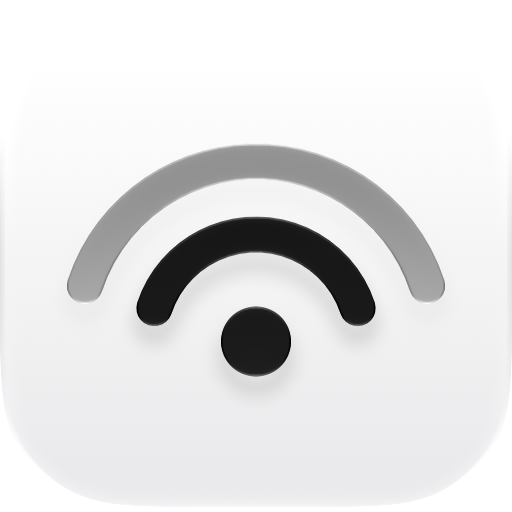
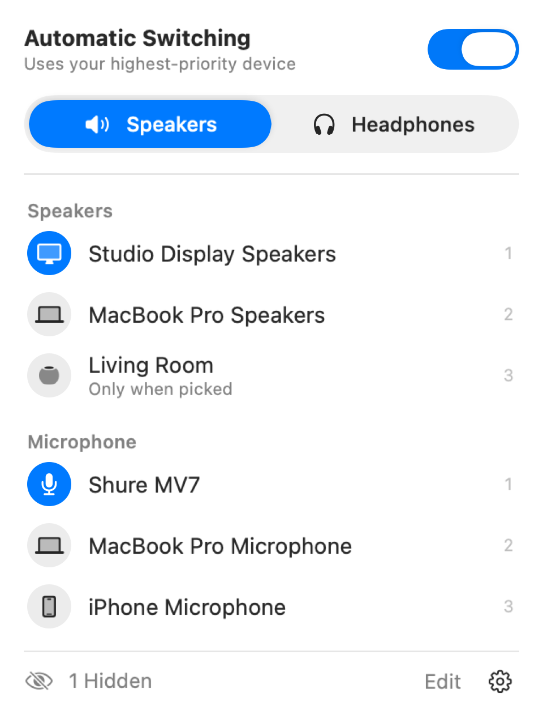

<p align="center">
  
</p>

<h1 align="center">Fermata</h1>

A macOS menu bar app that keeps your audio on the right device. Rank your speakers, headphones and microphones, and Fermata switches to the best one that's connected, then holds it there. It is derived from [Audio Priority Bar](https://github.com/tobi/AudioPriorityBar) by Tobi Lütke, rewritten for macOS 27.

<p align="center">
  
</p>

## Features

- **Priority lists** for speakers, headphones and microphones. Connecting headphones switches to the headphone list, and disconnecting them switches back.
- **Your picks are kept.** A device chosen in Control Center or System Settings, or a HomePod picked over AirPlay, stays until it disconnects.
- **Gentle on other audio apps.** The default device changes only when it needs to, and only after a new device has finished starting.
- **Microphone mute** from anywhere with ⌥⇧M, undone on quit.
- **Manual mode**, for when devices should change only when you pick one.
- **Automation.** Shortcuts actions, a Focus filter, and URLs such as `open fermata://toggle-mic-mute`. The other commands are `mute-mic`, `unmute-mic`, `toggle-automatic`, `enable-automatic`, `disable-automatic`, `speakers` and `headphones`.

## Install

Fermata needs macOS 27 on Apple silicon. With [Homebrew](https://brew.sh):

```bash
brew install --cask dylanhu7/tap/fermata
```

Or download the zip from the [latest release](../../releases/latest), unzip it and move Fermata to Applications. Releases are signed and notarized.

To build it yourself with Xcode 27.2 or later:

```bash
./build.sh install
```

## Use

- **Click** a device to use it now.
- **Drag** a row to change its priority.
- **Right-click** a row to hide it, mark it "only when picked", or move it between speakers and headphones.
- **Edit** shows disconnected and hidden devices.
- The **gear** menu has microphone mute, a separate microphone order for headphones, Open at Login and Quit.

## Differences from Audio Priority Bar

- **Fewer device changes.** Audio Priority Bar sets the default device on every CoreAudio event, which could hang apps such as Klack that restart their audio on each change. Fermata merges those events and changes a default only when it differs.
- **Picks made outside the app are respected**, rather than replaced by the top of the list the next time the devices change. If another app keeps taking the default, Fermata moves it back once and then leaves it.
- **Clicking a device selects it** without moving it to first place.
- **New:** microphone mute, Shortcuts, Focus filter, URL scheme, and icons that follow the device's model, so a renamed HomePod still looks like one.
- **Removed:** the volume slider.
- **Requires macOS 27 and Apple silicon.** Audio Priority Bar runs on macOS 13 and later.

## Development

The switching rules live in `Packages/FermataCore` and have no hardware dependency. The app in `Fermata/` talks to CoreAudio from an actor on its own queue.

```bash
swift test --package-path Packages/FermataCore
```

`./build.sh release` makes a notarized Developer ID build. It needs credentials saved once with `xcrun notarytool store-credentials fermata-notary`. A Debug build run with `--panel-window --demo --snapshot <path>` saves the panel as a PNG.

## License

MIT. See [LICENSE](LICENSE).
